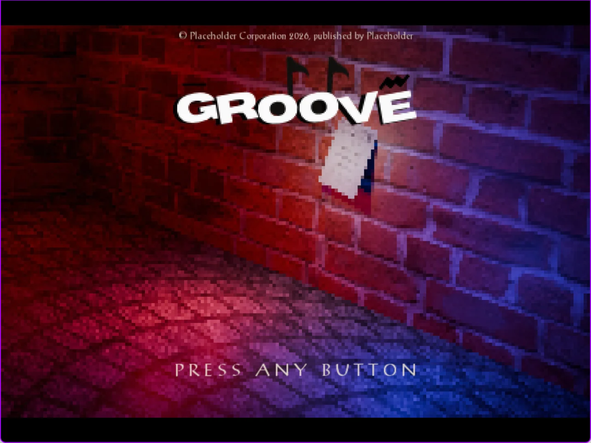
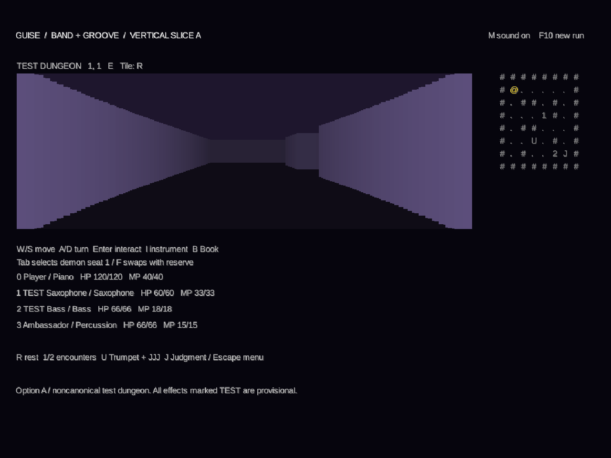
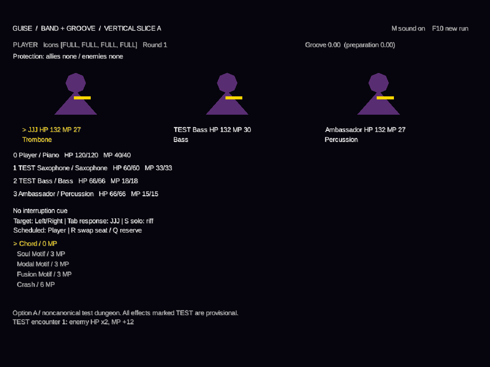

# GUISE

“The GROOVE is gone. The rhythm is yours to make.”

**A jazz-inspired, first-person dungeon-crawling RPG built in Java with LibGDX.**

GUISE combines the atmosphere of early PlayStation RPGs with grid-based exploration and turn-based combat built around musical roles. Party members form a **Band**, coordinate multi-character **Arrangements**, and generate **Groove** through their actions in combat.

Developed by **Michael Payams** as an independent, AI-assisted game project. I lead the game's design, narrative, visual direction, original artwork, and development decisions, building on an existing Java codebase I began before introducing AI assistance.

**Status:** playable mechanics vertical slice, with an implemented cinematic introduction and animated title screen. The interactive paper menu, settings interface, and final dungeon presentation are in development.


*In-engine screenshot of GUISE's current Java/libGDX title-screen presentation, featuring an original Blender-rendered environment. The interactive paper menu and final presentation remain in development.*

## Gameplay and presentation

- **First-person grid exploration:** tile-based movement, turning, collision, encounters, rewards, and a minimap generated from JSON map data.
- **Four-member party combat:** a Press Turn-style action economy, elemental affinities, status effects, enemy actions, instrument switching, and reserve swaps.
- **Band Arrangements:** coordinated abilities that validate musical roles, participating members, MP requirements, and action-icon costs before execution.
- **Groove tracking:** combat performance evaluated from recent action evidence, including cooperation, adaptation, variety, and recovery.
- **Discovery and Book progression:** successful combinations become known Arrangements that remain recorded during the session.
- **Judgment and Virtuoso harnesses:** isolated developer scenarios for validating performance gates and musicians with multiple instrument identities.
- **Cinematic presentation:** skippable opening narration, a logo reveal and flash sequence, an animated title screen, and timed sound cues with streamed music and ambience.
- **Content tooling:** a Java desktop DemonConfig editor for editing and validating demon data while preserving additional JSON fields.

### Mechanics prototype screenshots

These captures document the original Band A validation milestone. The geometric characters, purple walls, and debug-style interface are prototype visuals.

| Dungeon exploration | Party combat |
| --- | --- |
|  |  |

## Engineering approach

The project separates content definitions, session state, combat rules, and presentation. JSON files define moves, statuses, demons, races, Arrangements, and prototype maps; Java handles validation and runtime behavior.

Selected implementation details:

- **Action resolution and scoring:** combat produces typed result facts consumed by Groove calculations, keeping performance scoring separate from screen drawing.
- **Coordinated costs:** Arrangements charge participant MP and aggregate Press Turn costs without double-charging their component actions.
- **Session state:** party identity, HP/MP, discoveries, rewards, and encounter completion survive transitions between exploration and combat within a run.
- **Content integrity:** DemonConfig round-trip tests verify that editing known properties preserves unknown fields and explicit JSON nulls.
- **Grid rendering:** the current dungeon uses a compact, flat-shaded 2.5D raycaster over the same grid used for movement and collision. Textured 3D presentation is planned.
- **Audio ownership:** a shared cinematic audio manager transfers to the title screen so audio tails can continue across the transition and resources have a defined disposal owner.

## AI-assisted development

I use **ChatGPT/Codex** as a programming collaborator for architecture discussion, implementation, debugging, test development, and documentation. AI contributions include substantial code and regression-test work for the Band/Groove vertical slice and the cinematic presentation systems.

My role includes defining the game's mechanics and creative direction, supplying the existing project and content, setting implementation constraints, integrating changes, and evaluating the playable result. AI-generated code is part of this repository; I do not present it as entirely hand-written work.

The collaboration has included investigating a DemonConfig serialization bug, checking Arrangement cost and interruption behavior, and validating desktop rendering and packaged launches. Source inspection, automated tests, and manual playtesting inform whether changes are retained. The goal is to develop a game I can understand, maintain, and extend, with clear ownership of development decisions.

## Technology

| Area | Tools |
| --- | --- |
| Runtime | Java, LibGDX 1.14.0, LWJGL3 |
| Data | JSON, Gson |
| Tests | JUnit 5, desktop smoke-test harness |
| Build | Gradle wrapper; Java 11 source target; Java 21 Gradle daemon |
| Development | Eclipse, Git, GitHub |
| Art pipeline | Blender and exported textures/animation frames |

The game runtime is Java. Python and shell scripts support optional development and packaging workflows.

## Build and run

Install a **JDK 21** and run the included Gradle wrapper from the repository root. The first build requires access to the configured dependency repositories. A separate Gradle installation is unnecessary.

**Windows / PowerShell**

```powershell
.\gradlew.bat :lwjgl3:run
.\gradlew.bat :core:test
.\gradlew.bat :lwjgl3:jar
```

**Linux / macOS / Git Bash**

```bash
./gradlew :lwjgl3:run
./gradlew :core:test
./gradlew :lwjgl3:jar
```

The JAR task writes its runnable artifact to `lwjgl3/build/libs/`. The run task configures the asset working directory. For Eclipse, import the repository as an **Existing Gradle Project** and launch `com.payamsdev.oldsona.lwjgl3.Lwjgl3Launcher`; set a direct Java launch's working directory to the repository's `assets` folder.

In the prototype launcher, **F10** starts a fresh mechanics test run and **Enter** enters its dungeon. The paper menu's Start Demo entry is still in development. See [prototype controls and mechanics](README_SLICE.md) for the remaining controls and developer harnesses.

## Testing and validation

The recorded Band A milestone completed **47 tests: 47 passed, 0 failed, 0 skipped**. Coverage includes composition matching, MP and icon costs, affinities, status timing, interruptions, Groove calculations, discovery, encounter progression, Judgment state, and JSON round trips.

Desktop rendering, window resizing, packaged resources, and the runnable JAR were also exercised during that milestone. The recorded desktop checks ran on Linux x64 with software rendering; audio output used a null device, so those checks did not assess audible quality.

These are milestone results, not a live CI badge. Run `:core:test` to check the current checkout. The later intro-skip patch also passed 32 focused checks; that standalone check is separate from the JUnit suite.

- [Implementation report](IMPLEMENTATION_REPORT.md)
- [Validation methods and environment](VALIDATION.md)
- [Recorded test output](validation/automated-tests.txt)
- [Band/Groove specification](docs/GUISE_Band_Groove_Vertical_Slice_Specification.md)

## Project layout

| Path | Purpose |
| --- | --- |
| `core/src/main/java/` | Shared gameplay rules, screens, audio, and content tools |
| `core/src/test/java/` | Gameplay and content regression tests |
| `lwjgl3/` | Desktop launcher and packaging configuration |
| `assets/` | Runtime images, fonts, audio, maps, and game data |
| `docs/` | Vertical-slice specification |
| `tools/` | Development and packaging helpers |
| `validation/` | Recorded milestone reports and screenshots |

## Next milestones

1. Interactive paper menu with a Blender-authored zoom transition, configuration screen, and Start Demo entry.
2. Textured 3D dungeon presentation that preserves the existing grid movement, collision, and encounter rules.
3. A coherent dungeon HUD and exploration-to-combat demo flow.
4. Campaign entry and save/load support.

The current slice is deliberately limited: progression is held in memory, encounters use provisional balancing fixtures, and only the selected subset of the larger move catalog has runtime behavior. This is an actively developed prototype rather than a finished game.

## Project origins

The initial project structure was generated with [gdx-liftoff](https://github.com/libgdx/gdx-liftoff). GUISE's gameplay, content, tools, and presentation are built on [LibGDX](https://libgdx.com/).
